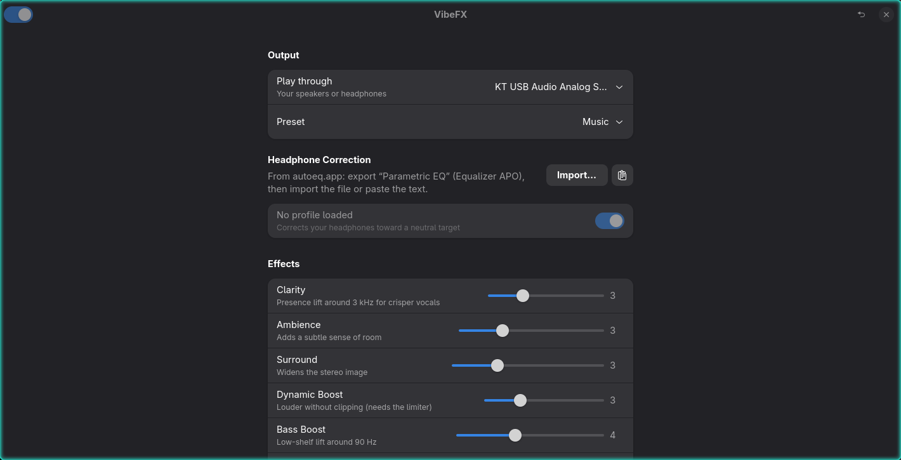

# VibeFX

FxSound-style audio enhancement for Linux desktops running PipeWire. A small
GTK4/libadwaita app with a tray icon: turn it on, pick a preset, and everything
you play gets clearer, wider and punchier.



## Features

- **Effects** (0–10, like FxSound): Clarity, Ambience, Surround, Dynamic Boost,
  Bass Boost, Fidelity
- **10-band equalizer** (31 Hz – 16 kHz, ±12 dB)
- **Presets**: Flat, Music, Movies, Gaming, Voice, Bass Boost, tuned from
  FxSound's own factory presets and common EQ practice
- **Headphone correction**: import any profile from [autoeq.app](https://autoeq.app)
  (Parametric, Fixed-band or Graphic EQ), as a file or pasted text
- **Limiter** for loudness without clipping (with `swh-plugins`)
- **Tray icon**: left-click opens, middle-click toggles effects, right-click for
  presets and quit; closing the window keeps it running in the tray
- **Launch at startup**, optionally straight to the tray
- **Update checks** against GitHub releases, with one-click install
- Changes apply live, with no audio dropouts

## How it works

VibeFX runs a PipeWire filter-chain (`vibefx.service`, a user unit) that
creates a virtual **VibeFX** output, applies the effects with PipeWire's
built-in filters, and plays into your real device. VibeFX is your default
output while the app runs; turning effects off switches the chain to a neutral
bypass instead of changing devices, so playback is never paused. Quitting hands
audio back to your device.

## Requirements

- PipeWire with WirePlumber (`pw-cli`, `pw-dump`, `pw-metadata`, `wpctl`)
- Python 3.12+ with PyGObject, GTK 4 and libadwaita 1.4+
- systemd (user session)
- Optional: `swh-plugins` for the limiter (enables Dynamic Boost)

On Arch: `sudo pacman -S python-gobject gtk4 libadwaita swh-plugins`

## Install

```bash
git clone https://github.com/HeyitsTayters/vibefx.git
cd vibefx
./install.sh
```

This installs to `~/.local` (no root): the `vibefx` command, an app launcher
entry, icons, and a login startup entry. Launch **VibeFX** from your app
launcher.

## Uninstall

```bash
./uninstall.sh
```

Settings stay in `~/.config/vibefx` until you delete them.

## Releasing

Update checks read the latest GitHub release. To publish one, bump `VERSION` in
`vibefx.py`, commit, then:

```bash
gh release create v1.2.3 --generate-notes
```

## License

MIT
